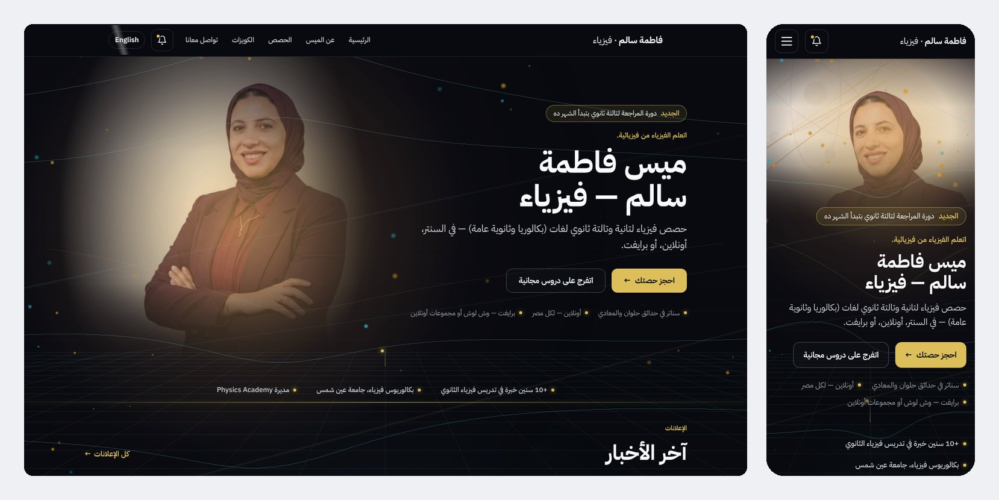
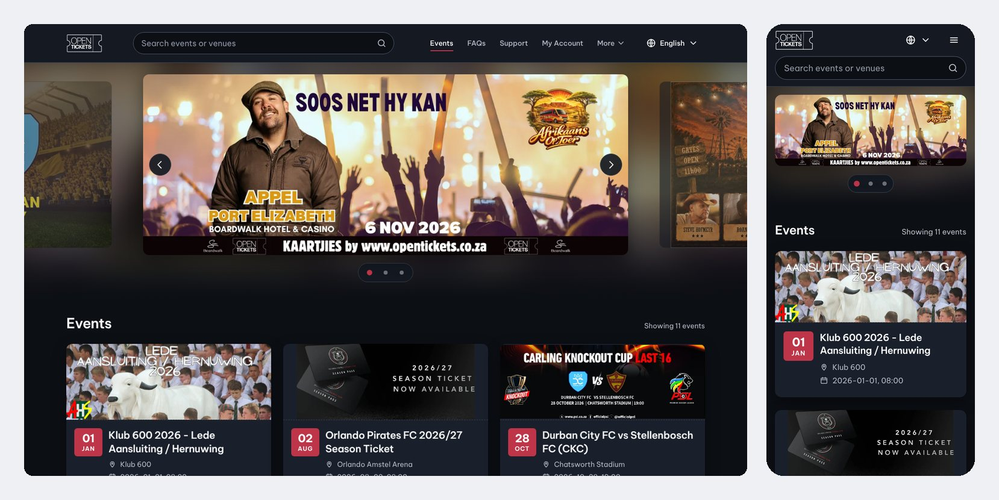
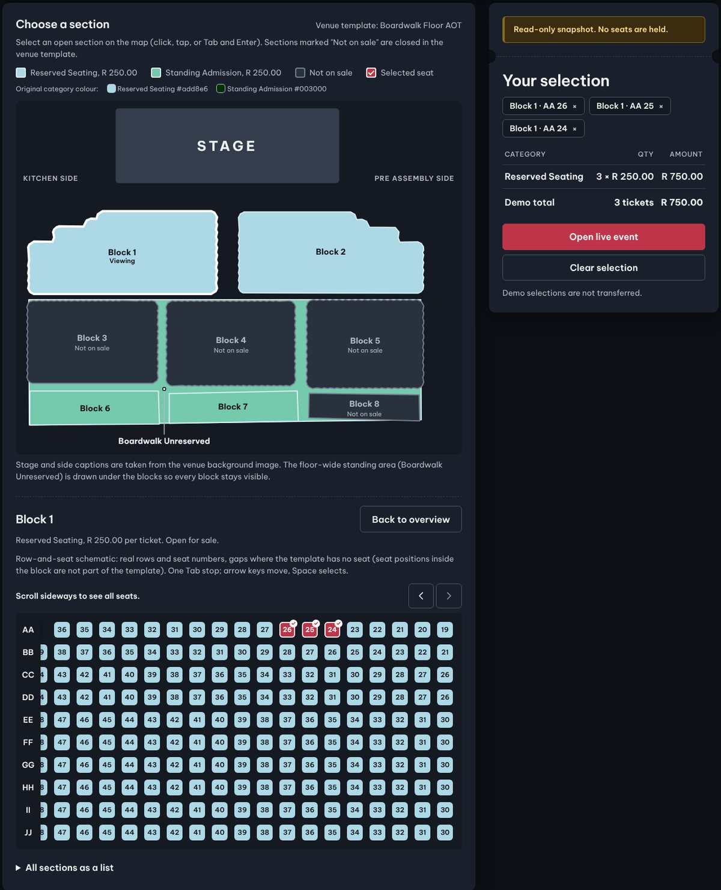
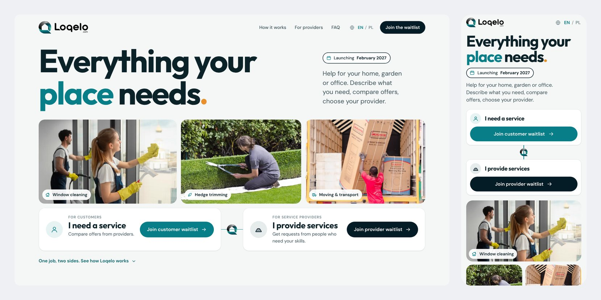

# Web Portfolio — Ahmed Shabayek

Websites and web apps I designed and built. Every project below has a live link you can open and try.

For my data engineering work, see my [GitHub profile](https://github.com/ashabaik).

---

## 1. Fatma Salem Physics — teacher website

**Live:** [fatma.physicsacademy.cloud](https://fatma.physicsacademy.cloud)

A public website for a secondary-school physics teacher in Egypt. Real client, live and in use.

- Arabic and English, with full right-to-left support
- Classes, centers, and weekly schedule
- Announcements, and a quizzes section with an admin area for grading and results
- Works on desktop and mobile
- Deployed and maintained on a VPS

I also run the teacher's social media pages (posts, content, videos, and ads, made with AI tools).

---

## 2. Event ticketing site — redesign and interactive seat map

**Live preview:** [opentickets-redesign-preview.pages.dev](https://opentickets-redesign-preview.pages.dev)

A redesign concept for a South African event ticketing website, built as a working site with the real events.

- New home page, event pages, search, and FAQ
- Interactive seat map built from the real venue layout: 9 sections, real rows and seat numbers
- Users pick a section, then seats or standing tickets, and see the total
- Keyboard support, and seats scroll sideways on phones
- Tested in Chrome and Safari engines

*Concept work: a contest entry, not a delivered client project. The seat map is a read-only demo — it never books or holds seats.*

---

## 3. Loqelo — pre-launch landing page

**Live demo:** [loqelo-prelaunch.pages.dev](https://loqelo-prelaunch.pages.dev)

A pre-launch landing page for a local services marketplace, built from the client's brand kit.

- Two waitlists: one for customers, one for service providers
- English and Polish
- Sign-up form with spam protection and email list integration
- Cookie consent with optional analytics
- Responsive on desktop and mobile

*Concept work: a contest entry, not a delivered client project.*

---

## How I work

- Clear scope and a fixed price before I start
- A live preview link early, so you can check progress
- I test on desktop and mobile before delivery
- I use AI tools to move faster, and I review and test everything myself

**Tools:** HTML · CSS · JavaScript · Cloudflare Pages · Git

## Contact

- LinkedIn: [linkedin.com/in/ahmed-mohamed-280481273](https://www.linkedin.com/in/ahmed-mohamed-280481273)
- Email: shabaik1996@gmail.com
